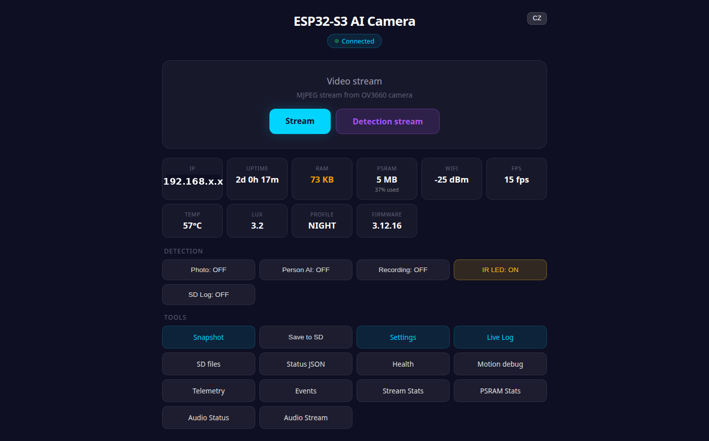
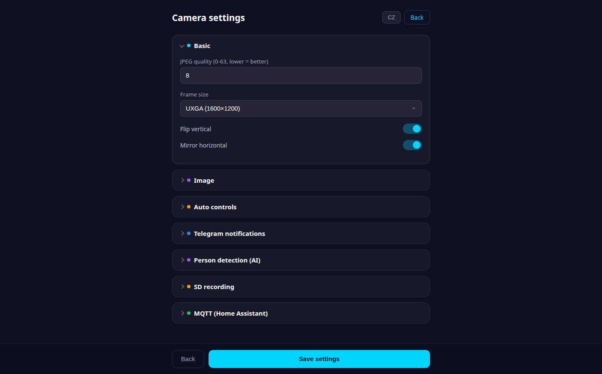

# DFR1154 AI Camera Firmware

[](https://github.com/PeterkoCZ91/DFR1154-ai-camera/actions/workflows/ci.yml)
[](https://platformio.org/)
[](LICENSE)


Firmware for the [DFRobot DFR1154](https://www.dfrobot.com/product-2730.html) AI camera module (ESP32-S3, OV3660, LTR-308 light sensor, PDM microphone). One capture task fills a PSRAM ring buffer that MJPEG and RTSP streaming, AVI recording, motion detection and on-device person detection (Edge Impulse FOMO with ByteTrack) all read from. It talks to Home Assistant over MQTT, sends Telegram alerts, records time-lapse and has a web dashboard with a live log. Nothing needs a cloud by default.

`a12_system/` is an optional Python companion, **A12**, that runs on a server or Raspberry Pi next to Home Assistant. It adds YOLOv11n verification, face recognition and door unlocking on top of the camera.

I run this on a door camera, so most recent work is about keeping it up for weeks at a time. All releases are in the [CHANGELOG](CHANGELOG.md); the latest:

- **3.12.54:** the planned low-heap restart could loop. The counter lived in a per-boot static, so the restart wiped it. It now has a 10-minute grace period and at most two restarts an hour.
- **3.12.53:** every restart path writes its cause to `/events` first. The reset reason the chip reports can't tell the firmware's own reboots apart.
- **3.12.52:** `/status` shows the MQTT link (`mqtt_connects`, `mqtt_link_uptime_s`, ...), so a link that keeps dropping is visible without a serial cable.
- **3.12.51:** every successful MQTT connect crashed the camera. `mqttLoop()` held `mqtt_mutex` and called a function that took the same mutex again.
- **3.12.50:** `setSocketTimeout(2)` on the MQTT client. A blocking connect had been taking HTTP and the stream offline every 10 s.

Older notes (3.12.49 and earlier) are in the CHANGELOG.

---

## Two Deployment Modes

| | **Standalone** | **Enhanced (A12 mode)** |
|---|---|---|
| Hardware | ESP32 only | ESP32 + server / Raspberry Pi |
| Person detection | FOMO on-device (~300–500 ms) | FOMO gates YOLOv11n via A12 (server-side) |
| UNCERTAIN detections | Direct Telegram (low-confidence caption) | MQTT → A12 YOLO verify → Telegram only if confirmed |
| Face recognition | No | Yes — YuNet + SFace (OpenCV) on the A12 host, no cloud |
| Auto door unlock | No | Nuki via Home Assistant, opt-in with a dry run first; skips a door a phone already opened (see [A12 companion](docs/A12_COMPANION.md)) |
| Telegram alerts | Yes — sent by ESP32 | Yes — sent by A12 (with face ID + AV clip) |
| AV clips | No | Yes — MP4 with audio |
| Home Assistant | MQTT (direct) | MQTT (direct + A12 enrichment) |
| `INCLUDE_TELEGRAM` | **On** | On in the default build; switch it off to free about 45 KB of heap if A12 sends every alert |
| `INCLUDE_AUDIO` | Optional | **On** (A12 uses audio:82 for clips) |
| Setup time | ~15 min (flash + configure) | ~30 min (flash + Docker + enroll faces) |

Standalone fits a camera that works on its own, say at a remote spot with no server. Enhanced needs a server or Pi that runs all the time; in return, uncertain detections are checked by YOLOv11n before an alert goes out.

---

## Table of Contents

- [Overview](#overview)
- [Who It's For](#who-its-for)
- [What You Need](#what-you-need)
- [Quick Start](#quick-start) (~15 min)
- [A12 Companion](docs/A12_COMPANION.md)
- [Public Release Scan](docs/PUBLIC_RELEASE_SCAN.md)
- [How It Works](#how-it-works)
- [Detection Pipeline](#detection-pipeline)
- [Features](#features)
- [Web Dashboard](#web-dashboard)
- [Telegram Bot](#telegram-bot)
- [API Reference](#api-reference)
- [System Architecture](#system-architecture)
- [Camera & Sensor Quirks](#camera--sensor-quirks)
- [Configuration](#configuration)
- [Compile-Time Feature Toggles](#compile-time-feature-toggles)
- [Known Issues & Limitations](#known-issues--limitations)
- [Troubleshooting](#troubleshooting)
- [Roadmap](#roadmap)
- [FAQ](#faq)
- [Real-World Deployment](#real-world-deployment)
- [Security & Privacy](#security--privacy)
- [Development History](#development-history)
- [Acknowledgments](#acknowledgments)
- [License](#license)

---

## Overview

**One capture task, several readers.** The OV3660 is read by a single `captureTask` into a ring buffer of three 256 KB PSRAM slots. MJPEG streaming, RTSP and dashboard snapshots read a slot in place; motion detection and AVI recording copy the frame out and release the slot straight away. Slot ownership is an atomic reference count (`-1` writer, `0` free, `>0` readers), so no reader waits on a mutex.

**Detection in three steps.** Block-based motion detection on an 80x60 grayscale image decides when to run Edge Impulse FOMO (about 300-500 ms at 64x64 int8, TFLite Micro with ESP-NN). Two consecutive positive frames are required, which removes most single-frame false positives, and a small ByteTrack-style Kalman tracker follows what it finds. The result is NONE, UNCERTAIN or CONFIDENT. Confident hits go to Telegram directly. Uncertain ones (60-75 %) are sent over MQTT to A12, which checks them with YOLOv11n and only then raises an alert.

**Built for long runs.** It has been in continuous use on a door camera for months. It includes Home Assistant MQTT discovery, a Telegram bot with fifteen commands, OTA updates, a captive-portal access point as WiFi fallback, credentials kept in NVS rather than `config.json`, a tamper watchdog, and day/dusk/night profiles driven by the lux sensor. Restarts are logged with a cause, so a camera that reboots can say why.

---

## Who It's For

- Home Assistant users who want a self-hosted camera that shows up through MQTT discovery (motion, person, IR LED, lux, audio).
- Anyone who wants person alerts with a photo or AVI clip in Telegram, without a subscription.
- People experimenting with small neural networks on a microcontroller.
- Embedded developers interested in the ring buffer, the FreeRTOS task layout, PSRAM use or the OV3660 register quirks.

---

## What You Need

### Hardware

| Part | Notes |
|------|-------|
| DFRobot FireBeetle 2 ESP32-S3 camera (DFR1154) | ESP32-S3 with OV3660 3 MP sensor, LTR-308 light sensor, PDM microphone and IR LED |
| MicroSD card | Class 10 / U1 or better, 8 GB or more, FAT32. Used for AVI recordings and time-lapse. |
| 5 V power supply | At least 1 A. WiFi, the sensor and the IR LED together draw more than a weak USB port gives. |

Optional:
- an external IR illuminator if you need night vision further than the built-in LED reaches
- a weatherproof enclosure for outdoor use
- a USB-C cable with data lines (charge-only cables won't flash)

### Software (All Free)

- [PlatformIO](https://platformio.org/), as the VS Code extension or the CLI, to build and flash
- [Home Assistant](https://www.home-assistant.io/), optional, picks the camera up through MQTT discovery
- [Mosquitto](https://mosquitto.org/) or any other MQTT broker, optional
- [Telegram](https://telegram.org/), optional, for alerts from a bot
- Python 3.12 (what the Docker image and CI use), only if you run the optional A12 companion

### Required Skills

You should be comfortable building and flashing an Arduino/PlatformIO project and finding a device's IP on your network. No machine learning knowledge is needed; the person model ships pre-trained. Home Assistant and MQTT setup only matter if you want them.

---

## Quick Start

> [!TIP]
> If you have never flashed an ESP32, follow [`docs/FIRST_FLASH.md`](docs/FIRST_FLASH.md). It covers installing PlatformIO, finding the serial port, boot-mode tricks, OTA updates and common errors.

```bash
# 1. Clone
git clone https://github.com/PeterkoCZ91/DFR1154-ai-camera.git
cd DFR1154-ai-camera

# 2. Build and flash (no credentials are compiled in; you set them on the device)
cd firmware
~/.platformio/penv/bin/pio run --target upload

# 3. Watch the serial output for the IP address
~/.platformio/penv/bin/pio device monitor

# 4. Open the dashboard in a browser
# http://<device-ip>/            (main UI)
# http://<device-ip>/log-viewer  (live log)
```

### Option B — Flash Pre-built Binary (no compiler needed)

Download `bootloader.bin`, `partitions.bin` and `firmware.bin` from [GitHub Releases](../../releases/latest) and flash them with esptool:

```bash
pip install esptool

esptool.py --chip esp32s3 --port /dev/ttyACM0 --baud 460800 write_flash \
  0x0000  bootloader.bin \
  0x8000  partitions.bin \
  0x10000 firmware.bin
```

On Windows use the COM port from Device Manager (for example `COM3`). On macOS it is usually `/dev/cu.usbmodem*`.

With no WiFi configured, the camera opens its own access point. See [First Boot](#first-boot).

### First Boot

On boot the firmware loads WiFi credentials from NVS. A freshly flashed board has none, so it starts an access point instead:

- **AP name:** `<device-name>_AP`. The default device name is `ESP32-Camera-` followed by a hex suffix from the board's MAC, so each board gets a different name.
- **AP password:** `12345678`
- Join it from a phone. The captive portal should open on its own; if it doesn't, go to `http://192.168.4.1/setup`.
- Enter your WiFi details and save. The camera reboots and joins your network.

Once it is on your network, open `http://<device-ip>/`. HTTP Basic Auth is on by default (`LAB_MODE false` in `config.h`) with `admin` / `admin`. Change that, and the AP password, under `/credentials` before the camera sits on a network you don't fully trust. For bench testing you can build with `-DLAB_MODE=1` to turn auth off.

Credentials are kept in NVS. NVS is not encrypted, so anyone with physical access to the board can read them.

> [!NOTE]
> The serial monitor prints `Local IP: http://192.168.x.x` once WiFi is up. The camera also announces itself over mDNS as `<device-name>.local` (the name is printed as `Device Name:` in the same block).

### First Configuration (Web Dashboard)

1. Open `http://<device-ip>/`.
2. Under **Settings**, adjust brightness, JPEG quality and motion sensitivity.
3. Turn **Photo: ON** to get a Telegram photo on motion. This needs a bot token and chat ID in `/credentials`.
4. Turn **Person AI: ON** to run the on-device FOMO person detector.
5. Open **Live Log** and walk in front of the camera to see events as they happen.

The UI starts in Czech; switch the language in the settings if you need English.

### Optional: A12 Companion (Enhanced mode)

`a12_system/` is a Python service that runs on a separate machine. It adds YOLO verification of people, face recognition (YuNet + SFace), audio/video clips, daily summaries, and an optional shared scorer when you run several cameras. The firmware works without it, and you can add it later without reflashing anything except the Telegram change below.

```bash
a12_system/tools/setup.sh
a12_system/tools/a12 doctor
a12_system/tools/a12 build
a12_system/tools/a12 up
a12_system/tools/a12 logs 80
```

The full runtime guide, the shared scorer contract, the face recognition flow and the CLI commands are in [`docs/A12_COMPANION.md`](docs/A12_COMPANION.md). Docker deployment and running several camera instances are in [`a12_system/DOCKER.md`](a12_system/DOCKER.md).

For the shared scorer, A12 keeps only counters in its statistics and daily summary: requests, successes, malformed responses, unreachable scorer, non-2xx answers, local fallbacks and request latency. Errors are recorded by exception class name and HTTP status code. Images, scorer URLs and exception messages are not stored there.

> [!NOTE]
> If A12 sends your alerts, turn off Telegram on the ESP32 so you don't get every alert twice. This also frees heap. Remove `-DINCLUDE_TELEGRAM` from `build_flags` in `firmware/platformio.ini` and reflash. See [Two Deployment Modes](#two-deployment-modes).

> [!IMPORTANT]
> **Public repository hygiene:** keep runtime config and private deployment data out of
> git. Do not commit `.env`, `config.env`, Telegram tokens, MQTT credentials, Home
> Assistant tokens, Wi-Fi credentials, logs, databases, face encodings, private
> screenshots, or model weights. Use placeholders such as `<camera-ip>` in issues and
> documentation. See [SECURITY.md](SECURITY.md), [SUPPORT.md](SUPPORT.md), and
> [`docs/DATA_PRIVACY.md`](docs/DATA_PRIVACY.md).

---

## How It Works

One FreeRTOS task, `captureTask` (task name `CamCapture`, core 1, priority 10), reads JPEG frames from the OV3660 at UXGA (1600x1200) by default. It copies each frame into a 3-slot ring buffer in PSRAM, 256 KB per slot. Slot ownership is tracked with an atomic reference count, so readers and the writer never wait on a mutex. A frame larger than a slot is dropped.

Several tasks read from that buffer. The MJPEG and RTSP streams send frames to clients. Motion detection, person detection, recording and time-lapse each take a reference, copy the frame into their own buffer, and release the slot quickly.

```
   OV3660 sensor (UXGA by default)
        |
        v
  +------------+      +-------------------+
  | captureTask|----->|  Ring Buffer      |
  | (Core 1,   |      |  3 x 256 KB PSRAM |
  |  prio 10)  |      |  atomic refcount  |
  +------------+      +---------+---------+
                                |
       +------------------------+----------------------+
       |              |              |             |
       v              v              v             v
  +---------+   +----------+   +----------+   +---------+
  | MJPEG   |   | motion   |   | recording|   |timelapse|
  | streams |   | detector |   | task     |   | task    |
  | (port81)|   |   |      |   |          |   |         |
  +----+----+   |   v      |   +----+-----+   +----+----+
       |        |  FOMO    |        |              |
       v        | person   |        v              v
   Web client   | detector |    AVI on SD     JPEG on SD
                |   |      |  /rec_<time>.avi  /YYYYMMDD/
                |   v      |
                | tracker  |
                +----+-----+
                     |
              PersonDecision
             /      |      \
          NONE  UNCERTAIN  CONFIDENT
         (drop)    |           |
                   v           v
            [MQTT connected?]  Telegram
            Yes |   No |    MQTT/HA
                v       v
           A12 YOLO   Telegram
          (verify)   (direct)
                |
             Person?
            Yes |
                v
       Face recognition
       (YuNet + SFace, in A12)
          /              \
   allowed resident,      anyone else
   face_unlock enabled         |
          |                    v
          v              Telegram (name
   door opens via         if known, else
   Home Assistant         unknown person)
   + Telegram report
```

Opening the door is off by default (`face_unlock.enabled: false`), and when you turn it on it starts as a dry run. When it is live, A12 opens the lock only for names listed in `face_unlock.names`. The face has to reach `face_unlock.min_score` (cosine similarity, default 0.60) on two separate checks of the same person track, and the person has to look at the lens for about a second. [`docs/A12_COMPANION.md`](docs/A12_COMPANION.md) describes every condition.

### Ring Buffer Protocol (CAS-Based)

```
  ref_count semantics:
   -1 = writer (captureTask) is writing to this slot
    0 = slot is free
   >0 = number of active readers

  Writer (captureTask):
    1. Starting after the newest slot, CAS ref_count 0 -> -1 on the first free one
       (if every slot is busy, skip this frame)
    2. memcpy the camera frame into the slot
    3. Store ref_count = 0 (release, SEQ_CST)
    4. Store current_frame_index = i (SEQ_CST), then wake the motion task

  Reader (any consumer task):
    1. idx = current_frame_index (atomic load)
    2. CAS ref_count N -> N+1; give up if it is -1 or after 16 collisions
    3. Read or copy the frame data
    4. Atomic decrement of ref_count
```

What this gives you:
- Readers never block the writer. If all three slots are held, the writer drops that frame instead of waiting.
- The writer never blocks readers. A reader that finds a slot being written tries again on the next frame.
- Several readers can hold the same frame at once.
- A slot is not overwritten while any reader still holds it.

---

## Detection Pipeline

Motion detection wakes the on-device person detector, a small tracker keeps IDs across frames, and the result is sorted into one of three states:

```
  Frame ----> [Motion: 80x60 grayscale, EMA background, 20x15 block grid]
                |
                |  motion confirmed (3 consecutive frames, clustered)
                |  (the person detector also runs an idle scan every 5 s)
                v
              [FOMO: 64x64 int8, ~314 ms (TFLite Micro + ESP-NN)]
                |
                |  raw detections (centroids)
                v
              [Tracker: constant-velocity prediction, persistent IDs]
                |
                |  2 consecutive positive frames + confirmed track
                v
         [PersonDecision: three-state]
                |
         +------+-------+----------+
         |              |          |
         v              v          v
       NONE         UNCERTAIN   CONFIDENT
     (discard)    (threshold    (>=75%)
                   to 75%)        |
                       |          v
                       |       Telegram
                       |       + MQTT/HA
                       v
              [MQTT connected?]
              Yes |      No |
                  v         v
             A12 YOLO   Telegram
             (verify)   (direct)
                  |
                  v
              Telegram
             (if YOLO OK)
```

### What Alert Will I Receive?

It depends on the confidence and on whether the camera has an MQTT connection:

| Result | Confidence | Standalone mode | A12 mode (MQTT connected) |
|--------|-----------|-----------------|--------------------------|
| **NONE** | < 60% | Nothing | Nothing |
| **UNCERTAIN** | 60–75% | Telegram photo (low-confidence caption) | MQTT → A12 YOLO verify → Telegram only if YOLO confirms |
| **CONFIDENT** | ≥ 75% | Telegram photo + HA/MQTT event | Telegram photo + HA/MQTT event |

Some examples:
- A person glimpsed at the edge of the frame usually comes out UNCERTAIN. Standalone, you still get a photo. With A12, YOLO drops it if there is no person.
- A person standing in front of the camera is CONFIDENT and you get a photo right away.
- A shadow, an animal or a swinging lamp is normally NONE and nothing is sent by the person path.

The routing checks only for a live MQTT connection, not for A12 itself. If a broker is connected but A12 isn't running, UNCERTAIN detections go to MQTT and nobody acts on them.

Both states fire once per new track and honour `person_detection_cooldown` (default 60 s). Telegram photos also respect the active hours; the MQTT hand-off to A12 does not. If the separate motion photo (`motion_telegram_photo`, off by default) is on and the person detector confirms nothing within 5 s of motion, the camera sends a "Motion detected (no person confirmed)" photo instead.

`person_confidence_threshold` (default 0.6) sets the NONE floor. `PERSON_CONFIDENT_THRESHOLD` (compile time, 0.75) sets the CONFIDENT floor. Everything between the two is UNCERTAIN.

### Motion Detection (motion_detection.cpp)

Block-based frame differencing against an EMA background model. Each JPEG is decoded at 1/8 scale, box-filtered to 80×60 grayscale and averaged into a 20×15 grid of 4×4 blocks. Analysis runs every 100 ms. I haven't re-measured the processing time since the switch to 80×60.

| Parameter | Value | Purpose |
|-----------|-------|---------|
| **Working resolution** | 80×60, grid 20×15 | Same grid as the M5Stack project, so zone coordinates carry over |
| Block size | 4 × 4 pixels | Averaging smooths out single noisy pixels |
| Block diff threshold | 28 + AGC gain, and > 12% of the background value | Absolute part follows sensor gain (gain 0 → 28, gain 30 → 58); the relative part stops bright areas like windows from triggering. Lowered to 0.7× while motion is active |
| Trigger percentage | 5% | Minimum share of blocks that must change |
| Trigger pct (night) | × 2.5 | Stricter at night |
| Upper bound | 50% | Above this it is treated as a global light change and rejected |
| Confirm frames | 3 | Consecutive frames required |
| EMA alpha (day) | 0.95 | Background adaptation rate |
| EMA alpha (night) | 0.98 | Slower at night to suppress sensor noise |
| Cluster requirement | 1+ neighbour (day), 2+ (night) | 8-connected adjacency |
| Brightness reset | Δ > 40/255 between frames | Background reset on sudden light change |
| ROI mask | Per-block on/off | Configurable via `/roi-mask` API |

The background trains for the first 20 frames after start, and nothing triggers during that time.

**Night mode** (average brightness < 10): the detector stays on but needs tighter clusters and 2.5× the trigger percentage. Real movement still gets through and most sensor noise does not.

**Sudden light change**: when the average brightness jumps by more than 40/255 between consecutive frames (lights switched on, headlights), the background is reset to the current frame so the transition doesn't read as motion.

### Person Detection (person_detection.cpp)

An Edge Impulse FOMO model runs on a copy of the newest JPEG from the ring buffer:

| Parameter | Value | Notes |
|-----------|-------|-------|
| Model | Edge Impulse FOMO | int8 quantized CNN |
| Input resolution | 64 × 64 grayscale | Fixed by FOMO architecture |
| Decode scale | JPG_SCALE_8X | UXGA → 200 × 150 → bilinear → 64 × 64 |
| Tensor arena | 140 KB PSRAM | |
| Min detections | 1 centroid | Noise is rejected by the temporal filter and tracker instead |
| Temporal filter | 2 consecutive frames | A confirmed tracker track is also required |
| Histogram normalization | 1%-99% percentile stretch | Skipped if the range is < 20 (true night) or > 200 (already full range) |
| Inference time | ~314 ms | Measured after the TFLite Micro + ESP-NN switch in v3.12.41 |

Besides motion wake-ups, the detector runs an idle scan every 5 s to catch people who arrive slowly or stand still. While someone is present it re-checks every `person_recheck_interval` seconds (minimum 5 s) and clears presence after 3 misses in a row.

### Object Tracker (tracker.cpp)

A small tracker loosely modelled on ByteTrack, with constant-velocity prediction and greedy nearest-neighbour matching (no full Kalman filter):

| Feature | Value | Notes |
|---------|-------|-------|
| Max tracks | 16 simultaneous | Static allocation |
| Track lifecycle | TENTATIVE → CONFIRMED → LOST → deleted | |
| Min hits to confirm | 2 | Tentative tracks are promoted after 2 matches |
| Max age | 30 frames | A lost track is deleted after 30 frames without a match |
| Max distance | 80 pixels | Matching radius. FOMO centroids are in 64×64 input coordinates, so in practice any detection matches the nearest track |
| Velocity smoothing | α = 0.7 (old) + 0.3 (new) | Exponential moving average |
| Persistent IDs | Yes | A person keeps the same track ID until they leave |
| Notification dedup | Yes | A `notified` flag stops repeat Telegram photos for the same track |

I added the tracker after the person re-check spam in v3.10.5. The same person now triggers one notification, and a new one only fires when a new track is created.

### Camera Profiles (ir_handler.cpp)

The firmware switches between three camera tunings based on ambient light from the LTR-308 sensor. The switching logic lives in `updateCameraProfile()` in `main.cpp`; the sensor code is in `ir_handler.cpp`.

| Profile | Lux range | Brightness | AE level | Gain ceiling | LENC | Use case |
|---------|-----------|------------|----------|--------------|------|----------|
| **DAY** | > 100 (back to DUSK below 60) | 0 | 0 | 16×, AGC auto | ON | Daylight, bright indoor |
| **DUSK** | 15–100 | +3 | +5 | 128×, AGC auto | ON | Twilight, dim indoor |
| **NIGHT** | < 15 (back to DUSK above 20) | +3 | +5 | 128× ceiling, AGC off | OFF | Very dark scenes |

The IR LED is controlled separately (see IR LED auto control below) and doesn't follow the profile.

If the sensor sits behind opaque plastic and always reads near zero, enable the IR LED's time-based schedule (`time_based`, `night_start_hour`, `night_end_hour` via `/ir-control`). The profile then follows the clock and only switches between DUSK and NIGHT.

**LTR-308 sensor:** 100 ms integration time and 100 ms measurement rate (500 ms in v3.10). The firmware reads it every 150 captured frames (about 5 s at 30 fps) from `captureTask`, right after the frame is returned, so the I2C read doesn't collide with the camera's SCCB traffic.

**OV3660 ISP tuning** (written once at init):
- LENC (lens correction) for corner vignetting
- BPC + WPC with auto adaptation to mask defective pixels
- SDE (Special Digital Effects) for contrast, saturation and brightness
- AEC zone weights that favour the lower part of the frame over windows at the top

2D noise reduction (register 0x5580) is deliberately left off because writing it inverted the image.

---

## Features

### :movie_camera: Streaming & Capture

| Feature | Description |
|---------|-------------|
| **MJPEG streaming** | Port 81: `/stream` at full speed for the browser, `/detection-stream` capped at 10 FPS for A12. Up to 2 clients each |
| **RTSP server** | Port 554 (`rtsp://device:554/mjpeg/1`) for VLC or an NVR |
| **Single-frame snapshot** | `/frame` returns the latest JPEG from the ring buffer without a new capture |
| **AVI recording** | MJPEG video + PCM audio interleaved (RIFF/AVI 1.0), stops automatically at 45 MB or 120 s |
| **Time-lapse mode** | Periodic JPEG snapshots saved to SD in per-day folders (`/sdcard/YYYYMMDD/tl_HHMMSS.jpg`), interval 5–3600 s |
| **Audio streaming** | PDM mic on port 82 (`/audio.wav`), 16 kHz mono PCM, continuous stream |
| **Multiple frame sizes** | UXGA, SXGA, XGA, SVGA, VGA, CIF, QVGA, set via `/settings`. The sensor starts at UXGA and smaller sizes are downscaled. A change reboots the camera |

### :eye: Detection & AI

| Feature | Description |
|---------|-------------|
| **Motion detection** | Block-based EMA background subtraction at 80×60, 8-connected clustering, AGC-aware threshold, ROI mask |
| **Night motion** | Stricter thresholds and clustering instead of switching detection off |
| **Sudden-light reset** | Background reset on Δ > 40/255 between frames (lights on/off) |
| **Person detection (on-device)** | Edge Impulse FOMO 64×64 int8 with histogram normalization and a 2-frame temporal filter. Output: `NONE` / `UNCERTAIN` / `CONFIDENT` |
| **Three-state decision + MQTT routing** | `CONFIDENT` (≥75%) → Telegram directly. `UNCERTAIN` (threshold to 75%) → MQTT `person_uncertain` → A12 YOLO verification → Telegram only if confirmed. Without MQTT, UNCERTAIN goes straight to Telegram |
| **PERF metrics** | Serial log line every 30 s: `infer_ms`, `motion`, `pd_pos/neg`, `tg_sent`, `fallback` |
| **Object tracker** | Persistent track IDs so one person produces one notification |
| **Day/Night auto-profiles** | LTR-308 ambient light sensor → DAY/DUSK/NIGHT camera tuning with hysteresis, or a clock schedule |
| **IR LED auto control** | Lux threshold (default 13 lux) with 20% hysteresis, or a time schedule; manual override via API |
| **OV3660 ISP tuning** | LENC, BPC/WPC auto, SDE, AEC zone weights (init-time SCCB writes) |
| **Server-side YOLO** | Optional: the A12 companion runs YOLO11n on the detection stream and gets full bounding boxes |
| **Face recognition** | A12 only. OpenCV YuNet detector + SFace embeddings on the YOLO person box, run only while the PIR reports someone in the doorway. By default an occurrence gets 20 checks with a usable face out of at most 30 attempts (`FACE_MAX_CHECKS_PER_EPISODE`, `FACE_MAX_ATTEMPTS_PER_EPISODE`), so frames without a face don't use up the budget. A resident must be recognised twice before an alert is suppressed; the door lock has its own score threshold and cooldown. Both models run on `cv2.dnn` from opencv-python-headless; the two model files go in the data directory next to the YOLO weights |
| **Sensor fusion** | A12 only. In `SECURITY` mode a person counts as `CONFIRMED_ALARM` when a Home Assistant sensor or the camera's own motion signal fired within the fusion window (default 10 s) |

### :house: Integrations

| Feature | Description |
|---------|-------------|
| **Home Assistant MQTT discovery** | Firmware creates binary sensors for motion and person, sensors for motion score, motion %, brightness, RSSI, free heap and uptime, switches for recording and person detection, and a snapshot button |
| **Telegram bot** | Text, photo and AVI document messages, plus 15 commands (see [Telegram Bot](#telegram-bot)) |
| **Zigbee2MQTT bridge** | A12 only. Subscribes to `zigbee2mqtt/+`; an occupancy event or an opened door contact starts a YOLO check |
| **Sensor fusion alarm** | A12 only. `CONFIRMED_ALARM` needs a person detection plus an HA sensor or camera motion within the window |
| **Other MQTT consumers** | The topics are plain MQTT, so Node-RED or HA automations (webhooks included) can use them directly |

### :wrench: Operations

| Feature | Description |
|---------|-------------|
| **OTA updates** | Upload firmware over HTTP to `/update`, no USB needed. There is no automatic rollback; a bad image needs a USB flash |
| **Live log viewer** | `/log-viewer` HTML page polling `/log` every 2 s (last 100 lines), with a download button |
| **WiFi captive portal** | Falls back to an access point named `<device_name>_AP` (default password `12345678`, change it with `ap_password`), with captive-portal redirects for Android and iOS |
| **NVS credential storage** | WiFi, MQTT, Telegram, HTTP and OTA credentials live in NVS, not in source code or `config.json`. NVS is not encrypted, so anyone with physical access to the flash can read them |
| **Web GUI dashboard** | Single page, dark theme: 10 info cards, 5 toggles and 14 tool links (see [Web Dashboard](#web-dashboard)) |
| **Health monitoring** | The camera restarts if `captureTask` hasn't updated its heartbeat for 10 s. Heap, RSSI and restart reasons are tracked and reported on `/health` |
| **Compile-time feature toggles** | Telegram, MQTT, audio, person detection, SD recording and time-lapse can be compiled out to save flash and RAM |
| **mDNS** | `http://<device_name>.local/` (`http://ESP32-Camera.local/` with the default name) |

### :shield: Reliability

| Feature | Description |
|---------|-------------|
| **Lock-free ring buffer** | Readers take a reference with atomic compare-and-swap instead of a mutex. Consumers copy the frame out and release the slot straight away |
| **Tamper detection** | Checked every ~5 s. If the image is black and motionless for ~30 s while the light sensor still sees light, or RSSI drops below −87 dBm, the camera sends a Telegram alert and logs an event (at most one alert per 10 min) |
| **Active hours** | Telegram photos only go out between `motion_notify_start_hour` and `motion_notify_end_hour` (e.g. 22–7 wraps past midnight) |
| **Cooldowns** | Motion photos default to 30 s apart, person photos to 60 s |
| **Watchdog** | Task watchdog on the main loop (180 s timeout) plus the camera heartbeat above |
| **Config persistence** | Settings are stored in `/config.json` on LittleFS (written to a temp file and renamed), credentials in NVS. Both survive a reboot |

---

## Web Dashboard

A dark, responsive web UI at `http://<device-ip>/`. Both pages are gzipped and compiled into the firmware (about 5 KB for the dashboard and 8 KB for settings), so they need no SD card or filesystem. Both have Czech and English text and a language toggle. The source is in `firmware/web/` and `tools/build_web_assets.py` embeds it.

<p align="center">
  
  &nbsp;
  
</p>

<p align="center">
  <em>Main dashboard (left) with info cards, detection toggles and tool links; collapsible settings form (right).</em>
</p>

**Top section:**
- **Header**: title and a status badge with a pulsing dot
- **Hero**: Stream and Detection stream buttons, both open port 81 in a new tab

**Info grid (10 cards):**
- **IP**: current IP address
- **Uptime**: formatted, e.g. `2d 14h 23m`
- **RAM**: free heap in KB, yellow below 100 KB and red below 50 KB
- **PSRAM**: free PSRAM with usage % underneath
- **WiFi**: RSSI in dBm, yellow below −65 and red below −80
- **FPS**: current stream frame rate
- **Temp**: chip temperature in °C
- **Lux**: ambient light from the LTR-308
- **Profile**: current camera profile (DAY / DUSK / NIGHT)
- **Firmware**: firmware version

**Detection toggles (5 buttons):**
- **Foto: ON/OFF**: motion → Telegram photo
- **Osoba AI: ON/OFF**: motion → FOMO → Telegram cascade
- **Nahrávání: ON/OFF**: SD AVI recording
- **IR LED: ON/OFF**: manual IR LED control
- **SD Log: ON/OFF**: start or stop the session-based SD debug logger

**Tools (14 links):**
- **Snapshot**: `/frame` (latest JPEG from the ring buffer)
- **Save to SD**: save the current frame to microSD
- **Settings**: `/settings-page` (the full settings form)
- **Live Log**: `/log-viewer`
- **SD files**: `/sd-list` (file browser)
- **Status JSON**: `/status` (raw JSON including temperature, FPS and PSRAM %)
- **Health**: `/health` (system health JSON)
- **Motion debug**: `/motion-debug` (per-block motion grid)
- **Telemetry**: `/telemetry` (heap and task metrics)
- **Events**: `/events` (detection event log)
- **Stream Stats**: `/stream-stats` (MJPEG stream diagnostics)
- **PSRAM Stats**: `/psram-stats` (ring buffer occupancy)
- **Audio Status**: `/audio-status`
- **Audio Stream**: direct link to `/audio.wav` on port 82

The dashboard polls the status every 3 seconds and shows **Offline** when the camera stops answering.

The **CZ/EN** button in the top-right corner switches all labels. The choice is saved in the browser's `localStorage` and also sent to the camera (`ui_language` in `/config.json`), so it survives a reboot and A12 uses the same language for its Telegram messages. The default is Czech.

---

## Telegram Bot

### Creating a Bot (one-time)

1. Open Telegram and search for **@BotFather**
2. Send `/newbot` and choose a name and username (e.g. `MyCameraBot`)
3. BotFather replies with your **bot token**: `123456789:ABC-DEF...`
4. Send `/start` to your new bot, then open: `https://api.telegram.org/bot<TOKEN>/getUpdates`
5. Find `"chat":{"id":...}` in the response. That number is your **chat ID**

### Configuring the Token

**Via web dashboard** (recommended): Settings → Telegram → paste token + chat ID → Save.

**Via A12 config.env** (Enhanced mode):
```env
TELEGRAM_BOT_TOKEN=<your-bot-token-from-@BotFather>
TELEGRAM_CHAT_ID=<your-chat-id>
```

The firmware polls Telegram every 30 s and only accepts commands from the configured chat ID, so a command can take up to half a minute to be picked up:

| Command | Description |
|---------|-------------|
| `/photo` | Take a photo and send it now |
| `/video N` | Record N seconds of AVI (3-60 s) and send as document |
| `/record` | Start AVI recording, or stop it and send the file |
| `/status` | Send system status (IP, uptime, heap, PSRAM, RSSI, IR, SD, detection settings, version) |
| `/detect` | Toggle motion → Telegram photo |
| `/person` | Toggle person detection AI cascade |
| `/ir on\|off\|auto` | IR LED control |
| `/hours HH-HH` | Set active-hours window for notifications |
| `/cooldown N` | Set cooldown between motion photos (5-3600 s) |
| `/threshold N.N` | Set AI confidence threshold (0.1-1.0) |
| `/watch` | Guard mode: motion photo, motion video, SD recording and person AI on, active hours 0–23 |
| `/silent` | Turn off motion photo, motion video, SD recording and person AI |
| `/ip` | Send network info (IP, SSID, web / stream / RTSP URLs) |
| `/restart` | Restart ESP32 |
| `/help` | Show command list |

**Cooldown:** motion photos are at least `motion_telegram_cooldown` apart (default 30 s), person photos `person_detection_cooldown` (default 60 s). Active hours (`motion_notify_start_hour` / `motion_notify_end_hour`, both inclusive) keep detection photos quiet outside the window.

**Photo upload:** uses `WiFiClientSecure.setInsecure()`, which skips certificate validation to fit the ESP32-S3's RAM. Someone on your network could intercept the upload. The multipart body is written in 512-byte chunks to keep TLS records small on weak WiFi.

**Document upload:** AVI files are streamed from SD without loading them into RAM. Files up to 50 MB are accepted.

## API Reference

The camera runs three HTTP servers (ports 80, 81, 82) and an RTSP server. The audio server exists only in builds with `INCLUDE_AUDIO`, and RTSP is left out of `LITE_MODE_NO_RUNTIME_TASKS` builds.

Endpoints that change state ask for HTTP Basic Auth: `POST /settings`, `GET`/`POST /credentials`, `POST /roi-mask`, `POST /zones`, `POST /ir-control`, `POST /record`, `POST /save_frame`, `POST /sd-clear`, `POST /update` and `POST /reboot`. A `LAB_MODE` build skips the check. Read-only endpoints are open.

### Main HTTP Server (Port 80)

#### Status & Diagnostics

| Endpoint | Method | Description |
|----------|--------|-------------|
| `/` | GET | Dashboard HTML (gzipped) |
| `/frame` | GET | Latest JPEG from the ring buffer |
| `/status` | GET | System JSON: IP, uptime, RSSI, heap, lux, profile, version, FPS, feature toggles, fitted `sensor`/`sensor_pid`, `lens_fov_deg` |
| `/health` | GET | Health JSON: WiFi state, sensors, tasks, camera state, stream health, fitted `sensor`, `lens_fov_deg` |
| `/telemetry` | GET | Counters: frames captured, motion events, inferences, errors, restarts |
| `/events` | GET | Recent event log as a JSON array, newest first (up to 100 entries: boot, motion, person, recording, Telegram, tamper, ...) |
| `/psram-stats` | GET | PSRAM usage |
| `/motion-status` | GET | Motion detector state, last trigger, EMA stats |
| `/motion-debug` | GET | HTML page showing the per-block motion grid |
| `/stream-stats` | GET | MJPEG client statistics |
| `/log` | GET | Last 60 log lines as plain text |
| `/log-viewer` | GET | HTML log viewer, refreshes every 2 s, with a download button |
| `/reg-debug` | GET | Sensor register dump (values read at init vs now) |

#### Configuration

| Endpoint | Method | Description |
|----------|--------|-------------|
| `/settings` | GET | Full configuration JSON |
| `/settings` | POST | Update configuration (partial JSON merge) |
| `/settings-page` | GET | Settings form HTML (gzipped) |
| `/credentials` | GET | Which credentials are set in NVS, without the secrets |
| `/credentials` | POST | Update WiFi/MQTT/Telegram credentials in NVS |
| `/roi-mask` | GET | Per-block ROI mask for motion detection |
| `/roi-mask` | POST | Update the ROI mask |
| `/zones` | GET | Named zones as JSON |
| `/zones` | POST | Add or update a zone: `{name, color, alert, rects: [{x, y, w, h}]}`. `{"delete": "<name>"}` removes one |

#### Control

| Endpoint | Method | Description |
|----------|--------|-------------|
| `/ir-status` | GET | IR LED state, auto mode, current lux |
| `/ir-control` | POST | `{state: "on"/"off"/"auto"}`; also accepts `auto_mode`, `threshold`, `time_based`, `night_start_hour` |
| `/audio-status` | GET | Audio level (dBFS) and trigger state |
| `/save_frame` | POST | Store the JPEG sent in the request body (max 500 KB) on the SD card as `/YYYYMMDD_HHMMSS.jpg` |
| `/record` | POST | `{action: "start"/"stop"}` starts or stops AVI recording |
| `/sd-list` | GET | Plain-text listing of the SD card root (up to 200 entries) with used/total MB |
| `/sd-download` | GET | `?file=...` downloads one file (`..` is rejected) |
| `/sd-clear` | POST | Deletes **every** file on the SD card; returns `files_deleted`, `freed_mb`, `remaining_mb` |
| `/sd-log` | GET | Status of the SD debug-log session |
| `/sd-log` | POST | `{action: "start", timeout_h: 4}`, `{action: "stop"}` or `{action: "flush"}`. While a session runs, log lines are buffered in RAM and written to SD every 60 s. No auth check |
| `/update` | GET | OTA upload page |
| `/update` | POST | OTA firmware update (raw binary body) |
| `/reboot` | POST | Restarts the board after a 500 ms delay; A12 uses it for recovery |

#### Captive Portal (AP mode only)

These endpoints return HTTP 403 in station mode, even in a `LAB_MODE` build that skips Basic Auth.

| Endpoint | Method | Description |
|----------|--------|-------------|
| `/setup` | GET | WiFi setup form |
| `/wifi-scan` | GET | Visible networks (up to 15) as JSON |
| `/wifi-save` | POST | Save WiFi credentials and reboot |
| `/generate_204` | GET | 302 redirect to `/setup` (Android captive portal check) |
| `/hotspot-detect.html` | GET | 302 redirect to `/setup` (iOS captive portal check) |

### Stream Server (Port 81)

Both streams are `multipart/x-mixed-replace` MJPEG from the same ring buffer, with boundary `123456789000000000000987654321`. They also answer `HEAD`.

| Endpoint | Description |
|----------|-------------|
| `/stream` | MJPEG at the capture rate, for the web GUI |
| `/detection-stream` | Same frames capped at 10 FPS, with its own client counter; this is what A12 reads. No overlay is drawn |

### Audio Server (Port 82)

| Endpoint | Description |
|----------|-------------|
| `/audio.wav` | Continuous WAV stream, 16 kHz mono PCM16: a 44-byte header, then raw samples |

### RTSP Server (Port 554)

```
rtsp://<device-ip>:554/mjpeg/1
```

The capture task feeds every frame to the RTSP server. Any client that plays MJPEG over RTSP should work; VLC and ffmpeg are the easy ones to test with.

### MQTT Topics

Two different things publish over MQTT, under different prefixes.

**Firmware** publishes under `esp32cam/<device_name>/` (`device_name` comes from the camera's config) and sends Home Assistant discovery under `homeassistant/`:

| Topic | Direction | Description |
|-------|-----------|-------------|
| `motion` | publish | `ON` / `OFF` |
| `motion_score`, `motion_percent` | publish | Motion score and changed area in % |
| `brightness` | publish | Average frame brightness |
| `person` | publish | `ON` / `OFF` for a confident person detection |
| `person_confidence` | publish | Confidence of that detection |
| `person_uncertain` | publish | `{"detected":true,"confidence":0.xx}` for a low-confidence hit, so A12 can check it |
| `status` | publish | JSON: `rssi`, `heap_kb`, `psram_kb`, `uptime_s`, `ip` |
| `recording_state` | publish | `ON` / `OFF` (retained) |
| `person_detection_state` | publish | `ON` / `OFF` (retained) |
| `cmd/snapshot` | subscribe | Take a snapshot |
| `cmd/recording` | subscribe | `ON` / `OFF` |
| `cmd/person_detection` | subscribe | `ON` / `OFF` |

**A12** publishes under `esp32_camera/` (change it with `MQTT_BASE_TOPIC`):

| Topic | Direction | Description |
|-------|-----------|-------------|
| `motion` | publish | `ON` / `OFF` motion state |
| `person` | publish | `ON` / `OFF` person detected |
| `face` | publish | Face recognition result (name or `unknown`) |
| `audio/alert` | publish | Loud noise trigger |
| `audio/status` | publish | Camera audio status JSON, relayed |
| `ir/status` | publish | IR LED state JSON, relayed |
| `rssi` | publish | WiFi signal strength |
| `status` | publish | `offline` (last will and on shutdown) |
| `camera/status/heartbeat` | publish | `ON` every 5 s |
| `camera/status/sabotage` | publish | `ON` when no frame has arrived for `security.sabotage_timeout` (default 90 s), `OFF` when it recovers |
| `camera/status/connection` | publish | `online` / `offline` |
| `camera/status/profile` | publish | `DAY` / `DUSK` / `NIGHT` |
| `camera/status/pipeline_state`, `stream_fps`, `decode_fps_target`, `frame_buffer_len`, `notification_queue`, `mem_mb`, `mem_pct` | publish | Pipeline and resource metrics |
| `camera/detection/classification` | publish | `CONFIRMED_ALARM` / `UNCONFIRMED_CAMERA` / `MONITOR_MODE` / `TEST_MODE` |
| `camera/detection/priority` | publish | `critical` / `normal` / `low` / `debug` |
| `camera/detection/sensor_confirmed` | publish | `true` / `false` (Zigbee fusion) |
| `camera/detection/score` | publish | Event score |
| `camera/detection/animal` | publish | Animal class name |
| `camera/alarm/trigger` | publish | `ON` when an alarm fires |
| `camera/config/status/mode` | publish | Current security mode |
| `camera/config/status/last_update` | publish | Time of the last config change over MQTT |
| `ir/set` | subscribe | Manual IR LED control |
| `ir/auto/set` | subscribe | IR auto mode toggle |
| `camera/config/set/#` | subscribe | Runtime config updates from HA (no prefix) |
| `zigbee2mqtt/+` | subscribe | External Zigbee sensors for fusion (no prefix) |
| `esp32cam/<device>/motion`, `esp32cam/<device>/person_uncertain` | subscribe | The firmware signals above |

---

## System Architecture

```
firmware/
 +-- main.cpp                       Entry point, WiFi, ArduinoOTA, NVS credentials, Telegram queue, loop
 +-- camera_server.cpp              HTTP servers (ports 80/81/82), endpoints, settings, OTA upload
 +-- camera_capture.cpp             Capture, motion and person tasks; ring buffer; pending sensor writes
 +-- camera_capture.h               Ring buffer protocol, FRAME_BUFFER_SLOT_SIZE
 +-- motion_detection.cpp           Block-based motion, EMA background, clustering, night mode
 +-- motion_detection.h             Motion constants, MOTION_GRID_W/H, ROI mask
 +-- person_detection.cpp           Edge Impulse FOMO inference, histogram normalisation, temporal filter
 +-- person_detection.h             FOMO config, PD_TEMPORAL_FRAMES
 +-- tracker.cpp / tracker.h        Simplified ByteTrack-style tracker, persistent track IDs
 +-- ir_handler.cpp                 LTR-308 lux, IR LED auto/manual, day/night profiles
 +-- audio_handler.cpp              I2S PDM microphone, /audio.wav streaming
 +-- avi_writer.cpp                 AVI 1.0 muxer, MJPEG video + interleaved PCM16
 +-- mqtt_handler.cpp               MQTT client, Home Assistant discovery
 +-- ws_log.cpp                     Live log ring buffer, /log and /log-viewer
 +-- sd_logger.cpp                  Optional SD debug-log sessions, /sd-log
 +-- event_log.cpp                  Event ring buffer behind /events
 +-- zone_manager.cpp               Named zones behind /zones
 +-- timelapse.cpp                  Periodic JPEG snapshots in per-day SD folders
 +-- config.h                       Compile-time toggles, struct definitions
 +-- board_config.h, camera_pins.h  DFR1154 pin map
 +-- task_priorities.h              FreeRTOS priority levels
 +-- platformio.ini                 Build environment (ESP32-S3, 16 MB flash, 8 MB PSRAM)
 +-- partitions.csv                 Partition table
 +-- MIGRATION_ESP_DL.md            Possible future move from FOMO to ESP-DL YOLOv11n
 +-- lib/
      +-- ei-person-detection-fomo/  Edge Impulse FOMO model and SDK
      +-- ESP32-RTSPServer/          RTSP server library (local copy)

a12_system/
 +-- __main__.py             Entry point (python -m a12_system)
 +-- camera.py               MJPEG stream reader with reconnect
 +-- detection.py            YOLO ONNX inference and face recognition
 +-- pipeline.py             Detection pipeline (motion -> YOLO cascade -> faces)
 +-- scorer_client.py        Client for a shared YOLO scoring service
 +-- face_*.py               Face backend (YuNet + SFace), quality, liveness, confirmation window
 +-- door_unlock.py          Decides whether a face verdict may open the door
 +-- presence_gate.py        Optional Home Assistant presence check for unlocking
 +-- nuki_log.py             Reads the lock's activity log
 +-- mqtt_client.py          MQTT v2 client with HA discovery
 +-- notifier.py             Telegram messages, GIF/MP4 clips
 +-- telegram_bot.py         Interactive Telegram bot
 +-- messages.py             Message catalogue (English source, Czech translation)
 +-- status_monitor.py       Heartbeat, sabotage detection, day/night profiles
 +-- ha_monitor.py           Home Assistant sensor polling for fusion
 +-- audio_monitor.py        Audio level threshold detection
 +-- database.py             SQLite event log
 +-- stats.py                Persistent statistics
 +-- runtime_config.py       Thread-safe runtime config with MQTT updates
 +-- logging_setup.py        Console and rotating file logs
 +-- config.py               Config loading (DEFAULT_CONFIG + env overrides)
 +-- config.env.example      Configuration template
 +-- test_*.py               44 test modules
 +-- requirements.txt        Python dependencies (paho-mqtt v2, OpenCV, pyTelegramBotAPI)
 +-- tools/
      +-- a12                CLI wrapper (status, logs, restart, build, up, down, doctor,
                             test-camera, config, setup, events, calibrate, review, tail, enroll)
      +-- enroll_sface.py    Face enrolment (SFace gallery + whitelist)
      +-- setup.sh           First-run data directory setup

firmware/web/
 +-- index_src.html          Dashboard source (cz/en strings)
 +-- settings_src.html       Settings page source (cz/en strings)
                             tools/build_web_assets.py embeds both into
                             camera_server.cpp as gzip arrays; CI runs it with
                             --check so the compiled page matches the source.

tools/
 +-- build_web_assets.py     Embed firmware/web/ into the firmware, or --check it
 +-- scan_ui_secrets.py      Reject real values posing as examples in the UI
 +-- pre_push_checks.sh      Project pre-push checks, chained from the global hook
 +-- serial_telemetry.py     Serial log -> SQLite
 +-- esp_monitor.py          HTTP health check and alerting
 +-- telegram_download.py    Photo collector using /frame
 +-- telegram_monitor.py     Telegram message log
 +-- brightness_test.py      Brightness analysis
 +-- stress_test.py          Load testing
 +-- serial_watch.sh         USB console capture that reopens after a panic
 +-- soak_sample.sh          One CSV row per minute: camera health + A12 counters
```

### Data Flow

The ring buffer has 3 slots of 256 KB in PSRAM. `captureTask` copies each JPEG into a free slot and hands it to RTSP. Readers take a reference on a slot, copy the frame out and release it straight away, so slow work never holds a slot.

```
 captureTask (core 1, prio 10, ~30 FPS)
    |-- RTSP frame
    |-- copy into ring buffer (3 x 256 KB, PSRAM)
    |-- apply pending sensor settings, every 150 frames read lux / IR / profile
    v  task notify
 motionTask (core 0, prio 2)
    |-- copies frame out, block motion detection
    |-- starts/stops SD auto-recording if sd_auto_record is on
    v  task notify on motion (in active hours, person detection enabled)
 personDetectionTask (core 0, prio 3)
    |-- copies frame out, FOMO inference (~300-500 ms)
    |-- tracker update, dedup by track ID + cooldown
    |-- confident: MQTT person + Telegram photo queue
    '-- uncertain: MQTT person_uncertain for A12 (Telegram if MQTT is down)

 Recording task  (core 1, prio 1)  copies frames out, writes AVI + PCM to SD
 Telegram task   (core 0, prio 3)  sends queued messages to the Bot API over TLS
 Timelapse task  (core 0, prio 1)  periodic JPEG snapshots
 MJPEG / HTTP handlers             read the ring buffer the same way
```

Stack sizes: capture, motion and person detection 8 KB each, recording 6 KB, Telegram 32 KB, timelapse 4 KB.

---

## Camera & Sensor Quirks

> [!WARNING]
> The OV3660 has several behaviours that the `sensor_t` API does not document. Each workaround below took a few tries.

### SCCB Bus Contention

The OV3660 registers are accessed over SCCB, an I2C-like bus. The `esp32-camera` driver uses that bus during capture. In my testing, `set_reg()` or `get_reg()` calls from other tasks while `captureTask` was capturing failed silently: reads came back as `0xFF` and writes did not stick.

What it looked like:
- `POST /settings` returned 200 OK but nothing changed
- Values reverted, or the log showed failed register writes
- Register reads returned `0xFF` across the board

The workaround is a pending-write mechanism in `captureTask`:
1. The HTTP handler stores the new values in `pendingSensorValues` and sets `pendingSensorAction`.
2. After `esp_camera_fb_return()`, when the bus is free, `captureTask` calls `applyPendingSensorSettings()`.
3. The writes happen in the task that owns the bus.

A settings change therefore takes effect about one frame later.

### LTR-308 I2C Bus Sharing

The LTR-308 ambient light sensor sits on the same GPIO 8/9 as the camera's SCCB. Reading it from a separate task ran into the same contention.

Lux is now read from `captureTask` after `esp_camera_fb_return()`, every 150 frames (about every 5 s at 30 FPS). Other tasks get the cached value through a non-blocking getter.

### OV3660 Cannot Upscale

The driver allocates its frame buffers for the resolution used at init. You can switch to a smaller frame size at runtime but not to a larger one, so a camera initialised at VGA cannot later move to UXGA.

The firmware therefore always initialises at UXGA (1600 × 1200) when PSRAM is present and then sets the configured frame size. The cost is 256 KB ring buffer slots instead of 64 KB.

### ESP-NN — EON Export Incompatibility (resolved in v3.12.41)

With `ESP_NN=1`, an Edge Impulse FOMO model exported with the **EON Compiler** (`EI_CLASSIFIER_COMPILED=1`) caused heap corruption or a watchdog reset on the DFR1154. A static DRAM arena, a PSRAM arena and a larger arena all failed the same way, which points at the EON runtime rather than the memory budget.

The fix is to export the model as **TFLite Micro** (untick EON Compiler under Deployment in Edge Impulse Studio). The standard TFLite Micro interpreter works with `ESP_NN=1` on the ESP32-S3, and inference dropped from about 3500 ms to 300–500 ms.

```ini
; platformio.ini — only valid with TFLite Micro export (EI_CLASSIFIER_COMPILED=0)
build_flags =
    -DEI_CLASSIFIER_TFLITE_ENABLE_ESP_NN=1
```

> [!WARNING]
> If you re-export the model and pick the EON Compiler by mistake, the first inference ends in `CORRUPT HEAP` or `TG1WDT_SYS_RST`. Export as TFLite Micro again and reflash.

### Camera Init Pixel Correction

Some OV3660 modules have stuck pixels that show up as bright dots in dark frames, and the default BPC/WPC settings miss some of them.

At init the firmware writes registers that `sensor_t` does not expose. On an OV3660 only, it enables BPC/WPC auto-adaptation (`0x5025`), SDE (`0x5001`) and sets the ISP control register `0x5000` with LENC, gamma, BPC and WPC on; the OV5640 uses those bits for other blocks. The AEC zone weights (`0x5688`–`0x568F`) are written on both the OV3660 and the OV5640, which share that register map.

> [!WARNING]
> Do not write register `0x5580` (2D noise reduction) on this OV3660 revision. Writing `0x40` there inverts the image. `initCamera()` skips it on purpose.

---

## Configuration

Settings live in `/config.json` on LittleFS. Credentials (WiFi, Telegram, HTTP auth, OTA, AP, MQTT user and password) live in NVS. NVS is not encrypted, so anyone with physical access to the flash can read them. Both can be changed from the web GUI or over the API (`/settings` and `/credentials`).

The defaults below are what a board gets on first boot, when no `config.json` exists yet. Out-of-range values in a loaded file are clamped to the listed range.

### Camera Settings

| Parameter | Default | Range | Description |
|-----------|---------|-------|-------------|
| `frame_size` | 13 (UXGA 1600×1200) | 0-13 | Frame size enum. The sensor is initialised at UXGA and only smaller sizes can be applied. Changing it reboots the camera. A firmware version change resets anything below UXGA back to UXGA. |
| `jpeg_quality` | 12 | 5-63 | Lower means better quality and larger files. A firmware version change raises values below 12 to 12. |
| `flip_vertical` | true | bool | Set over the API as `vflip` |
| `flip_horizontal` | true | bool | Set over the API as `hmirror` |
| `lens_fov_deg` | 0 | 0-220 | Horizontal FOV of the fitted lens, entered by the owner (`0` = unknown). The firmware detects the sensor but cannot detect the lens. |

Sensor tuning (`brightness`, `contrast`, `saturation`, `sharpness`, `denoise`, `ae_level`, `gainceiling`, and so on) is not stored in `config.json`. Boot applies DUSK-profile values (brightness 3, contrast 1, saturation -1, sharpness 0, denoise 3, ae_level 5, gain ceiling 128×, BPC/WPC/LENC on), and the DAY/DUSK/NIGHT light profiles overwrite them whenever the profile changes. Values posted to `/settings` take effect immediately but last only until the next profile switch or reboot. The OV3660 driver accepts brightness -3..3 and ae_level -5..5, a wider range than the usual ±2.

### Detection Settings

| Parameter | Default | Range | Description |
|-----------|---------|-------|-------------|
| `motion_detection_enabled` | true | bool | Firmware motion detection |
| `motion_telegram_photo` | false | bool | Send a photo on motion |
| `motion_telegram_video` | false | bool | Send an AVI clip when motion stops |
| `motion_telegram_cooldown` | 30 s | 5-3600 | Minimum interval between motion photos |
| `motion_notify_start_hour` | 0 | 0-23 | Start of active hours |
| `motion_notify_end_hour` | 23 | 0-23 | End of active hours; wrapping past midnight is supported |
| `person_detection_enabled` | false | bool | Motion → on-device model → Telegram/A12 cascade |
| `person_telegram_photo` | true | bool | Send a photo on a CONFIDENT or UNCERTAIN detection, independent of `motion_telegram_photo` |
| `person_confidence_threshold` | 0.6 | 0.1-1.0 | Detections below this are NONE and are dropped |
| `person_detection_cooldown` | 60 s | 5-600 | Minimum interval between AI-triggered photos |
| `person_recheck_interval` | 12 s | 5-120 | How often the model re-runs while the same track is still present |

The upper threshold (≥ 0.75 = CONFIDENT) is not a config key. It is the compile-time constant `PERSON_CONFIDENT_THRESHOLD` in `firmware/person_detection.h`.

### SD Recording & Time-lapse

| Parameter | Default | Range | Description |
|-----------|---------|-------|-------------|
| `sd_auto_record` | false | bool | Start recording on motion |
| `sd_auto_record_duration` | 30 s | 3-300 | Keep recording this long after the last motion |
| `sd_max_usage_percent` | 90 | 10-99 | Delete the oldest files above this usage |
| `sd_record_fps` | 10 | 1-30 | AVI frame rate |
| `timelapse_enabled` | false | bool | Periodic JPEG capture |
| `timelapse_interval_sec` | 60 | 5-3600 | Time-lapse interval |

The default build does not start the recording or time-lapse tasks (see `LITE_MODE_NO_RUNTIME_TASKS` below), so these settings do nothing until that define is removed.

### MQTT

| Parameter | Default | Description |
|-----------|---------|-------------|
| `mqtt_enabled` | false | Enable the MQTT client |
| `mqtt_server` | (empty) | Broker IP or hostname |
| `mqtt_port` | 1883 | 1-65535 |
| `mqtt_user` | (empty) | Stored in NVS, set via `/credentials` |
| `mqtt_pass` | (empty) | Stored in NVS, set via `/credentials` |

---

## Compile-Time Feature Toggles

Feature switches live in two places. `INCLUDE_TELEGRAM` is set in `firmware/platformio.ini` under `build_flags` (`-DINCLUDE_TELEGRAM`) so it applies to every translation unit. The rest are in `firmware/config.h`:

```cpp
#define INCLUDE_MQTT          // MQTT + Home Assistant discovery
#define INCLUDE_AUDIO         // I2S/PDM microphone + audio streaming
#define INCLUDE_PERSON_DETECT // On-device person detection (Edge Impulse model)
#define INCLUDE_SD_RECORDING  // SD card AVI recording + auto-delete
#define INCLUDE_TIMELAPSE     // Periodic JPEG snapshots to SD
```

To drop a feature, comment out its `#define` (or remove `-DINCLUDE_TELEGRAM` from `build_flags`) and rebuild. The code is excluded by `#ifdef` guards. I build and run the default configuration. Other combinations are not tested regularly, so expect to fix a compile error now and then.

`config.h` also defines `LITE_MODE_NO_RUNTIME_TASKS`, which is on by default. It keeps the code compiled but skips starting the RTSP server, the SD recording task and the time-lapse task at boot. Audio is not affected. With it off, an overnight test dropped `min_free_heap` to about 13.5 KB and ended in a crash loop, so turning it off on a board that also runs Telegram is not recommended.

`LAB_MODE` (default `false`) turns off HTTP Basic Auth on the mutable endpoints. Enable it only for bench work:

```bash
PLATFORMIO_BUILD_FLAGS="-DLAB_MODE=1" ~/.platformio/penv/bin/pio run --target upload
```

---

## Known Issues & Limitations

> [!NOTE]
> HTTP Basic Auth is on by default (`LAB_MODE false` since v3.12.5) with the credentials `admin / admin`. Change them under Settings → Credentials before the camera goes on a network you don't trust. `/health` reports `default_credentials: true` until you do.

<details>
<summary><strong>Hardware / Platform limitations (won't fix)</strong></summary>

- **The OV3660 cannot upscale at runtime.** The camera initialises at UXGA and only smaller frame sizes can be applied.
- **SCCB bus contention.** `set_reg`/`get_reg` calls from the HTTP handlers fail because `captureTask` holds the bus. Settings are queued with a pending flag and applied inside `captureTask`.
- **The I2C bus is shared with the LTR-308.** The light sensor and the camera SCCB both use GPIO 8/9, so lux reads are scheduled from `captureTask` between frames.
- **ESP-NN needs a TFLite Micro export.** The EON Compiler export (`EI_CLASSIFIER_COMPILED=1`) corrupted the heap with ESP-NN enabled. Since v3.12.41 the model is exported as TFLite Micro (`EI_CLASSIFIER_COMPILED=0`). See [ESP-NN quirks](#esp-nn--eon-export-incompatibility-resolved-in-v31241).
- **The PDM mic is 16 kHz mono.** Stereo or a higher sample rate needs an external I2S MEMS mic on other GPIOs.
- **arduino-esp32 is pinned to 3.0.0.** Newer cores (3.3.0+) show `cam_hal: DMA overflow` with the inference workload.

</details>

<details>
<summary><strong>Software limitations</strong></summary>

- **RTSP, SD recording and time-lapse are off in the default build** because of `LITE_MODE_NO_RUNTIME_TASKS` (see above). The A12 pipeline uses `/frame` and `/detection-stream` over HTTP and does not need them.
- **The ESP32 does not poll Telegram for commands.** `getUpdates` polling was disabled because every TLS session left a heap fragment and after about an hour sends started failing. The camera only sends. Bot commands are handled by A12 (`telegram_bot.py`).
- **No HTTPS.** All HTTP endpoints are plain. Telegram uses TLS through `WiFiClientSecure.setInsecure()`, which skips certificate validation, so a MITM on the LAN is possible.
- **Credentials in NVS are not encrypted.**
- **No OTA rollback.** There is no automatic fallback to the previous image if a new one fails to boot. Keep a USB cable within reach when flashing over the air.
- **Small-object false positives.** The model runs on a 64×64 input, so small or distant objects are noisy. The temporal filter (2 consecutive frames) and the tracker (2 hits before a track is confirmed) catch most of them, not all. `firmware/MIGRATION_ESP_DL.md` describes a possible move to ESP-DL.
- **AVI recording stops at 45 MB or 120 s.** There is no segmented recording.
- **MQTT backs off under memory pressure.** Reconnects are deferred while free heap is below 60 KB.
- **Low heap restarts the board.** Free heap below 30 KB for 15 s forces a restart. Below 50 KB for 60 s triggers a planned restart, limited to two per hour and not within 10 minutes of boot. The reason appears in `/health` as `last_restart_reason_name` and in the event log.
- **Time-lapse and per-day SD folders need NTP.** Without internet access there is no per-day organisation.
- **The web UI ships as a gzipped PROGMEM array** in `camera_server.cpp`. Edit `firmware/web/*_src.html`, regenerate the arrays with `tools/build_web_assets.py`, then rebuild. Editing the array by hand does not work.
- **No multi-camera coordination.** Each camera runs on its own.

</details>

<details>
<summary><strong>Compared to alternatives</strong></summary>

The columns for the other projects are based on their READMEs when I wrote this and may be out of date.

| Aspect | This project | s60sc/ESP32-CAM_MJPEG2SD | ESPHome Camera | jameszah/ESP32-CAM-Video-Recorder |
|--------|:------------|:-------------------------|:---------------|:----------------------------------|
| Lock-free ring buffer | :white_check_mark: CAS protocol | :x: Mutex-based | :x: | :x: |
| On-device person detection | :white_check_mark: Edge Impulse model + tracker | :x: | :x: | :x: |
| Day/Night/Dusk profiles | :white_check_mark: 3-level + LTR-308 | :warning: 2-level | :x: | :x: |
| MQTT HA discovery | :white_check_mark: Auto | :warning: Manual config | :white_check_mark: | :x: |
| RTSP server | :warning: Off in the default build | :white_check_mark: | :x: | :x: |
| AVI recording with audio | :warning: Off in the default build | :white_check_mark: | :x: | :white_check_mark: |
| Time-lapse | :warning: Off in the default build | :white_check_mark: | :x: | :x: |
| Live log viewer | :white_check_mark: HTML + auto-refresh | :white_check_mark: WebSocket | :x: | :x: |
| FTP/WebDAV upload | :x: | :white_check_mark: | :x: | :x: |
| Intercom (2-way audio) | :x: | :white_check_mark: | :x: | :x: |
| Server-side cascade | :white_check_mark: Python A12 + YOLOv11 | :x: | :x: | :x: |
| Compile-time toggles | :white_check_mark: 6 features | :white_check_mark: | :x: | :x: |
| License | MIT | GPL | MIT | MIT |

</details>

---

## Troubleshooting

<details>
<summary><strong>Camera doesn't show up on the network after flashing</strong></summary>

**Symptom:** no IP in the serial monitor, dashboard unreachable.

- **No or wrong WiFi credentials.** The camera falls back to an access point named `<device_name>_AP` (on a fresh board `ESP32-Camera-<chip id>_AP`), password `12345678` unless you set an AP password. Join it from a phone and the captive portal opens, or browse to `/setup`.
- **5 GHz network.** The ESP32-S3 supports 2.4 GHz only.
- **Client isolation on the router.** Turn it off for this network.
- **The IP changed.** DHCP can hand out a different address after a reboot. Use `<device_name>.local` or a DHCP reservation.

</details>

<details>
<summary><strong>Build fails with "DMA overflow" or memory errors</strong></summary>

**Symptom:** `cam_hal: DMA overflow` or `Guru Meditation Error` at boot.

**Cause:** arduino-esp32 3.3.0+ has a regression with the inference workload and DMA buffers, also reported on the [Edge Impulse forum](https://forum.edgeimpulse.com/t/14723).

**Fix:** keep the core pinned to 3.0.0 in `platformio.ini`, which is the project default:
```ini
platform_packages =
    framework-arduinoespressif32 @ https://github.com/espressif/arduino-esp32.git#3.0.0
```

</details>

<details>
<summary><strong>Person detection has too many false positives at night</strong></summary>

**Symptom:** detections on noise in dark frames, IR LED reflections or moving shadows.

**Cause:** stretching the histogram of a dark frame amplifies sensor noise, and the model was trained on full-range images.

**Already in place:** `normalizeContrast()` skips frames with a pixel range below 20, the temporal filter needs 2 consecutive positive frames, and the tracker needs 2 hits to confirm a track.

**Fix:** raise `PD_TEMPORAL_FRAMES` from 2 to 3 in `firmware/person_detection.h` and rebuild, or restrict notifications to daytime with `motion_notify_start_hour` / `motion_notify_end_hour`.

</details>

<details>
<summary><strong>Telegram bot doesn't respond to commands</strong></summary>

**Symptom:** no reply to `/photo`, `/status` and so on.

**Cause:** the firmware does not poll Telegram for commands (see Known Issues). Commands are answered by A12.

**Fix:**
- Run A12 with `TELEGRAM_ENABLED=true`, `TELEGRAM_BOT_TOKEN` and `TELEGRAM_CHAT_ID` set in `config.env`.
- In a group chat, the bot must be a member. [@userinfobot](https://t.me/userinfobot) shows your chat ID.
- If the camera's own notifications don't arrive either, check the token and chat ID with `GET /credentials` (`telegram_token_set`, `telegram_chat_id`) and fix them with `POST /credentials`. The camera needs outbound HTTPS (port 443).

</details>

<details>
<summary><strong>SD card recording fails to start</strong></summary>

**Symptom:** `/record` answers `"No SD card"` or `"Failed to start recording"`, serial shows `SD Card Mount Failed`.

- **Card not detected.** Reseat it or try another card. The firmware already retries the mount at 1 MHz when 4 MHz fails.
- **Wrong filesystem.** Format as FAT32. The ESP32 SD library does not read exFAT.
- **Card too slow.** Use Class 10 / U1 or better.
- **Recording starts but nothing is written.** The default build does not run the recording task. See `LITE_MODE_NO_RUNTIME_TASKS`.

</details>

<details>
<summary><strong>MQTT not connecting / no Home Assistant entities</strong></summary>

- **Broker address wrong or empty.** `GET /settings` shows `mqtt_enabled` and `mqtt_server`; set them with `POST /settings`. `/status` reports `mqtt_connected`, `mqtt_state` and the failure count.
- **Broker not running.** Check with `mosquitto_sub -h <broker> -t '#'` from another machine.
- **Wrong MQTT credentials.** Look for failed auth in the broker log. `GET /credentials` shows whether a password is set.
- **Discovery prefix mismatch.** The firmware publishes under `homeassistant/`, which must match the discovery prefix in Home Assistant.
- **Low heap.** Reconnects are skipped while free heap is below 60 KB. Check `free_heap` in `/health`.

</details>

<details>
<summary><strong>Camera restarts every 30-200 seconds</strong></summary>

**Symptom:** the dashboard keeps reconnecting, A12 reports the stream as lost.

Start with `/health`: `last_restart_reason_name`, `power_restarts_brownout`, `restarts_1h` and `power_health`.

- **Brownout or power-on resets.** The supply is too weak or the cable drops voltage. Use at least 5 V 1 A. The IR LED and WiFi transmit peaks draw more.
- **`heap_low_planned` or `heap_critical`.** The heap guard restarted the board (see Known Issues). Look at `free_heap` and `max_alloc_heap` in `/status` to see what is eating memory.
- **Task watchdog.** The WDT timeout is 60 s (`main.cpp`, `esp_task_wdt_init`). A WDT reset means a task hung, and the panic output is only readable over USB serial.
- **Weak WiFi.** `wifi_rssi` in `/status` or `/health`. Below about -85 dBm the link is unreliable.
- **A12 sabotage alarm, no actual restart.** The camera is up but A12 flags stream loss. Raise `security.sabotage_timeout` in A12's `config.json` (default 90 s). Sabotage detection is only on in SECURITY mode.

</details>

<details>
<summary><strong>Factory reset</strong></summary>

Erase the whole flash, which clears NVS credentials and `config.json`, then flash again:

```bash
cd firmware
~/.platformio/penv/bin/pio run --target erase
~/.platformio/penv/bin/pio run --target upload
```

The board then boots into AP mode for fresh setup.

</details>

---

## A12 CLI

`a12_system/tools/a12` is a small shell wrapper around Docker Compose for running A12.
The commands you will use most are `setup`, `doctor`, `build`, `up`, `logs`, `restart`
and `down`. It also has `status`, `config`, `test-camera`, `events`, `tail`,
`calibrate`, `review` and `enroll`; `a12 help` lists them all.

The full command table and multi-instance examples are in
[`docs/A12_COMPANION.md`](docs/A12_COMPANION.md#a12-cli) and
[`a12_system/DOCKER.md`](a12_system/DOCKER.md).

---

## Roadmap

Everything above [Future Features](#future-features) has shipped. The working list is
in [`TODO.md`](TODO.md).

### Detection Improvements (TIER 1 — done in v3.11)

| Feature | Status | Description |
|---------|--------|-------------|
| Temporal filter for person detection | :white_check_mark: Done | A person is confirmed only after 2 consecutive positive frames |
| Histogram clamp at true night | :white_check_mark: Done | The contrast stretch is skipped when the pixel range is below 20, so IR noise is not amplified |
| Night motion detection (relaxed) | :white_check_mark: Done | A stricter cluster check and a 2.5× trigger percentage at night, instead of suppressing motion altogether |
| Background reset on light changes | :white_check_mark: Done | The EMA background is reset after a brightness jump of more than 40/255 |
| LTR-308 sample rate 5× faster | :white_check_mark: Done | 100 ms instead of 500 ms, so the profile reacts sooner to sunset or headlights |

### Detection Improvements (TIER 2/3 — done in v3.11)

| Feature | Status | Description |
|---------|--------|-------------|
| ByteTrack-style tracker | :white_check_mark: Done | Persistent track IDs (`tracker.cpp`) so one person does not trigger repeated notifications; about 1 KB of SRAM |
| OV3660 HDR + DPC + 2D denoise | :white_check_mark: Done | SCCB register writes at init (LENC, BPC/WPC auto, SDE, 2D-NR) |
| Motion detection detail | :white_check_mark: Done | Motion runs on an 80×60 working image with a 20×15 grid |

### Other Features (done in v3.11)

| Feature | Status | Description |
|---------|--------|-------------|
| Compile-time feature toggles | :white_check_mark: Done | `INCLUDE_TELEGRAM`, `INCLUDE_MQTT`, `INCLUDE_AUDIO`, `INCLUDE_PERSON_DETECT`, `INCLUDE_SD_RECORDING`, `INCLUDE_TIMELAPSE` |
| Live log viewer | :white_check_mark: Done | `/log` as plain text, `/log-viewer` as an auto-refreshing HTML page |
| Time-lapse mode | :white_check_mark: Done | Periodic JPEGs to SD in per-day folders |
| Per-day SD folders | :white_check_mark: Done | `/sdcard/YYYYMMDD/` for both AVI and time-lapse |
| Web dashboard overhaul | :white_check_mark: Done | Info cards, toggles and tools on one page, dark theme, CZ/EN switch |
| A12_System v2 (Python) | :white_check_mark: Done | Split into modules, paho-mqtt v2, thread safety fixes, persistent event database |

### A12 Companion — Decision Auditing (done 2026-08)

| Feature | Status | Description |
|---------|--------|-------------|
| Decision audit + retention | :white_check_mark: Done | Every YOLO/policy decision is stored with the thresholds that applied to it |
| Learning-data retention | :white_check_mark: Done | `person/`, `candidates/` and `misses/` are kept past the 2-day media sweep, so old audit rows still have their images |
| Candidate + miss snapshots | :white_check_mark: Done | Keeps the frame behind decisions that save no other media, including sensor triggers where nobody was found |
| Ground truth (`a12 review`) | :white_check_mark: Done | Human verdicts go to `decision_labels` and are never pruned; `a12 calibrate` reports precision per confidence band |
| Scorer telemetry | :white_check_mark: Done | Transport, HTTP-status and malformed-response failures are counted separately, with latency p50/p95/max; no payloads or URLs are kept |
| Inference latency in `events.db` | :white_check_mark: Done | `decision_audit.inference_seconds` records how long the inference behind each decision took. `a12 review --stats` reports p50/p95/max per outcome |

### Future Features

None of these has a date.

| Feature | Status | Description |
|---------|--------|-------------|
| Occupant-aware alerting | :bulb: Planned | Alert on an unrecognised person rather than on any person. At home nearly every person alert is someone who lives there. Face recognition and whitelist suppression exist in A12, but `FACE_RECOGNITION_ENABLED` is off by default and face sizes at typical distances are often too small to match. |
| Known/unknown in ground truth | :bulb: Planned | `a12 review` labels only `person`, `not_person` and `unsure`. Splitting `person` into resident and stranger would let the labels feed recognition, not only threshold tuning. |
| ESP-DL YOLOv11n pedestrian | :warning: Blocked | PlatformIO `custom_component_add` does nothing under `framework = arduino`; this needs a hybrid `arduino, espidf` build. See `firmware/MIGRATION_ESP_DL.md`. |
| Lux-gate for FOMO | :bulb: Planned | Skip FOMO inference when ambient lux is below a threshold. The LTR-308 is already read every frame. Only useful if the sensor can see out of the enclosure. |
| Dedicated YOLO stream endpoint | :bulb: Planned | A lower-resolution (SVGA/VGA) variant of `/detection-stream` so A12 spends less CPU on JPEG decoding. |

---

## FAQ

<details>
<summary><strong>Do I need Home Assistant?</strong></summary>

No. The camera runs on its own with the web dashboard, the MJPEG stream and the Telegram
bot. Home Assistant adds MQTT auto-discovery and remote control. A12 needs an MQTT
broker, but any broker will do.

</details>

<details>
<summary><strong>Can I use this with Frigate / BlueIris / Synology Surveillance Station?</strong></summary>

Usually, yes. The simplest source is the MJPEG stream at `http://<device-ip>:81/stream`.

The firmware also has an RTSP server (`rtsp://<device-ip>:554/mjpeg/1`), but the default
build does not start it: `LITE_MODE_NO_RUNTIME_TASKS` in `firmware/config.h` skips RTSP,
the recording task and time-lapse to leave enough heap for Telegram's TLS handshake.
Comment that define out and rebuild if you need RTSP. Expect less free heap afterwards.

</details>

<details>
<summary><strong>How accurate is the on-device person detection?</strong></summary>

The Edge Impulse FOMO model works on a 64×64 grayscale input. It does best when a person
is fairly large in a well-lit frame. It does poorly with:

- distant people (small targets)
- side views and partly hidden people
- low light
- groups (FOMO gives centroids, not bounding boxes)

I have not measured its precision or recall. For better accuracy, run the YOLOv11n
check in `a12_system/` on a machine on your LAN.

</details>

<details>
<summary><strong>How much does it cost to run?</strong></summary>

The hardware in the parts list comes to roughly $45 (board, SD card, power supply).
There is no subscription or cloud service. A12 needs a machine that can run Docker.
I have not measured power draw.

</details>

<details>
<summary><strong>What happens when WiFi goes down?</strong></summary>

- The firmware retries the connection with a backoff that starts at 10 s and grows to
  60 s between attempts.
- MQTT publishes fail until the link is back. The MQTT socket timeout is 2 s, so a dead
  broker does not stall the main loop.
- Telegram messages are dropped, not buffered: the send task discards a queued message
  if WiFi is down when it gets to it.
- Local SD recording does not need WiFi, but the recording task is off in the default
  build (see the Frigate answer above).

</details>

<details>
<summary><strong>Can I add multiple cameras?</strong></summary>

Yes. Flash the same firmware to each board. A board with no saved config gets the
default name `ESP32-Camera-<chip id>`. That name is used for both the mDNS hostname and
the MQTT topic prefix (`esp32cam/<device_name>`). A board that already has a
`/config.json` without a `device_name` falls back to `ESP32-Camera`, and two boards with
the same name collide on mDNS and on MQTT. Give each board its own `device_name`. See
[Running Two Boards on One Network](docs/DFROBOT_HARDWARE_GUIDE.md#5-running-two-boards-on-one-network).

</details>

<details>
<summary><strong>Does the camera work in complete darkness?</strong></summary>

The board has an IR LED. In auto mode it uses a 13 lux threshold with 20 % hysteresis:
on below about 10 lux, off above about 16 lux. The firmware switches to the NIGHT
profile below 15 lux. I have not measured how far the IR LED reaches.

Two things to check in an enclosure: the IR LED needs its own opening, or it only lights
the inside of the box, and the LTR-308 light sensor needs one too, or it reads near 0 lux
all day and keeps the camera in NIGHT. The workaround for a blocked sensor is in
[`docs/DFROBOT_HARDWARE_GUIDE.md`](docs/DFROBOT_HARDWARE_GUIDE.md).

</details>

<details>
<summary><strong>Can I record 4K?</strong></summary>

No. The OV3660 is a 3 MP sensor and the firmware runs it at UXGA (1600×1200) by default.
An OV5640 module (5 MP) also fits the board's connector and runs with the same firmware,
but that is still nowhere near 4K, and the ESP32-S3 could not encode or store 4K anyway.

</details>

---

## Real-World Deployment

I have run this at home since late 2025: one DFR1154 at the front entrance, with A12 in
a container on a small server on the same LAN, plus a second DFR1154 as a bench unit.
The numbers below come from that setup and from [CHANGELOG.md](CHANGELOG.md).

### Hardware Tested

| Board | Sensor | Notes |
|-------|--------|-------|
| DFRobot FireBeetle 2 ESP32-S3 (DFR1154) | OV3660 3 MP | The reference platform, in daily use since late 2025 |
| DFR1154 with an OV5640 DVP module (65° lens) on the same flex | OV5640 5 MP | Runs unmodified on the bench board; `sensor` reports `OV5640` and the OV3660-only tuning is skipped |

The firmware recognises an OV2640 but I have not tested one. Other ESP32-S3 boards need
their own pin map in `firmware/board_config.h`; the classic ESP32 (AI-Thinker ESP32-CAM)
is not supported.

### Memory Profile (v3.12.41)

| Metric | Value |
|--------|-------|
| Static DRAM | 20.6 % (67,644 bytes) |
| Free heap after a person-detection inference | ~79 KB |
| PSRAM ring buffer | 768 KB (3 × 256 KB slots) |
| PSRAM FOMO tensor arena | 140 KB |
| PSRAM log buffer (`ws_log`) | ~9.4 KB (60 × 160 chars, moved from DRAM in v3.12.40) |
| PSRAM `sd_logger` buffer | 4 KB (moved from DRAM in v3.12.40) |
| PSRAM total | 8 MB |

### Performance Metrics

| Metric | Value |
|--------|-------|
| FOMO inference time | ~314 ms on the production board (v3.12.41), ~253 ms on the bench board |
| A12 detection stream | Capped at about 10 FPS in the firmware |
| Telegram `getUpdates` poll interval | 30 s |
| Motion detection latency | Not measured for the current 80×60 working image |
| Continuous uptime | Multi-day uptime observed since v3.12.34 |

---

## Security & Privacy

The full data-privacy write-up is [`docs/DATA_PRIVACY.md`](docs/DATA_PRIVACY.md): what is
processed, what can leave your LAN and how to turn it off, face data, and retention.
Reporting a vulnerability: [`SECURITY.md`](SECURITY.md).

The firmware is built for a trusted home LAN. The limits are listed below.

<details>
<summary><strong>Data handling</strong></summary>

- Motion and FOMO detection run on the camera. A12 runs YOLO and face recognition on
  your own machine.
- The firmware sends no telemetry or analytics.
- Recordings go to the SD card, and to your Telegram chat or MQTT broker if you enable
  those. Telegram traffic passes through Telegram's servers.
- A12 has an optional Groq vision path (`groq_vision.py`) that sends camera frames to
  an external API. It is off unless you set `GROQ_API_KEY`.
- The live log buffer is in RAM only and is lost on reboot.

</details>

<details>
<summary><strong>Network exposure</strong></summary>

- **Port 80**: HTTP API and dashboard. Basic auth protects the endpoints that change
  state (`/settings`, `/record`, `/credentials`, `/update`, and others); most read-only
  endpoints are open. The default login is `admin`/`admin`. `/health` reports
  `default_credentials: true` until you change it. Basic auth over plain HTTP sends the
  password in clear text. With `LAB_MODE` (off by default) there is no auth at all.
- **Port 81**: MJPEG streams, no auth.
- **Port 82**: audio WAV stream, no auth.
- **Port 554**: RTSP, no auth. Not started in the default build.
- **Port 3232**: ArduinoOTA. No password unless you set an OTA password.
- **AP fallback**: if WiFi fails at boot, the camera opens an access point named
  `<device_name>_AP`, with password `12345678` unless you set your own.
- **Outbound**: Telegram over HTTPS, MQTT over plain TCP (the firmware has no MQTT TLS).

The Telegram client calls `setInsecure()`, so the firmware does not check Telegram's
TLS certificate. Someone who can intercept your traffic could read the bot token and
the images.

Firmware updates go through `POST /update` or ArduinoOTA. The image is not signed, and
nothing in the code rolls back automatically if a new image fails to boot.

> [!WARNING]
> Put the camera on an isolated IoT VLAN and do not expose ports 80, 81, 82, 554 or 3232
> to the internet. If you need remote access, use a VPN or a reverse proxy with HTTPS
> and its own authentication.

</details>

<details>
<summary><strong>Credential storage</strong></summary>

These are stored in NVS (the `creds` namespace), not in `/config.json`:

- WiFi SSID and password
- HTTP basic auth user and password
- OTA password
- AP mode password
- Telegram bot token and chat ID
- MQTT user and password

NVS is **not encrypted** in this build. Anyone with physical access to the board can
read these values from flash. `GET /credentials` returns only whether each password is
set, not the password itself, but the AP password is printed on the serial console.

</details>

---

## Development History

The project started in October 2025 as a way to try out the DFR1154 camera board. Full
details are in [CHANGELOG.md](CHANGELOG.md).

| Phase | Versions | Focus |
|-------|----------|-------|
| **Foundation** (Oct 2025) | v1.x — v2.x | Camera driver, MJPEG streaming, basic block-based motion detection |
| **Core services** (Nov 2025) | v3.0 — v3.5 | Ring buffer, RTSP server, OTA, sabotage detection, LTR-308 day/night profiles, AP fallback, PDM audio |
| **Features** (Dec 2025 — Jan 2026) | v3.6 — v3.9 | Credentials in NVS, HTTP basic auth, FOMO person detection, AVI recording, DUSK profile |
| **Home Assistant** (Feb — Mar 2026) | v3.10 | MQTT sensors and discovery, OV3660 brightness tuning |
| **Detection v2** (Apr 2026) | v3.11 | Temporal filter, ByteTrack tracker, night motion rework, OV3660 ISP tuning, time-lapse, live log, feature toggles; A12 rewritten as v2 |
| **Hardening** (Apr — May 2026) | v3.12.x | Concurrency fixes, SCCB bus conflict fix, watchdog, Telegram heap fragmentation fixes (v3.12.32–34), TFLite Micro with ESP-NN (v3.12.41) |
| **Recovery** (Jul — Sep 2026) | v3.12.49 — v3.12.54 | `POST /reboot` and the A12 recovery ladder, 2 s MQTT socket timeout, bounded heap-restart ladder; A12 decision audit and local face recognition |
| **Face unlock** (Oct 2026) | A12 | Door unlock by face through Nuki Hub, with frontal-look and liveness checks |

---

## Acknowledgments

- [Edge Impulse FOMO](https://www.edgeimpulse.com/blog/announcing-fomo-faster-objects-more-objects/): the on-device person detection model
- [esp32-camera](https://github.com/espressif/esp32-camera): Espressif's camera driver
- [ESP32-RTSPServer](https://github.com/rjsachse/ESP32-RTSPServer): RTSP server library (local copy in `firmware/lib/`)
- [PlatformIO](https://platformio.org/): build and flash toolchain
- [Home Assistant](https://www.home-assistant.io/): MQTT discovery target
- [Ultralytics YOLO](https://github.com/ultralytics/ultralytics): YOLOv11n ONNX models for A12
- [OpenCV](https://opencv.org/): runs YOLO and the YuNet/SFace face models in A12
- [s60sc/ESP32-CAM_MJPEG2SD](https://github.com/s60sc/ESP32-CAM_MJPEG2SD): ideas for features such as time-lapse
- [ByteTrack](https://github.com/ifzhang/ByteTrack): reference for the tracker algorithm
- DFRobot, for documenting the FireBeetle 2 ESP32-S3 camera board well

---

## License

MIT License. See [LICENSE](LICENSE) for details.

---

## Contributing

1. Fork the repository.
2. Create a feature branch (`git checkout -b feature/my-feature`).
3. Build the firmware (`cd firmware && pio run`). From the repository root, run the
   same checks as CI: `ruff check .` and `pytest -q`.
4. Open a pull request that says what changed and why.

[CONTRIBUTING.md](CONTRIBUTING.md) has the setup details. Bug reports and feature
requests go to [GitHub Issues](../../issues).
